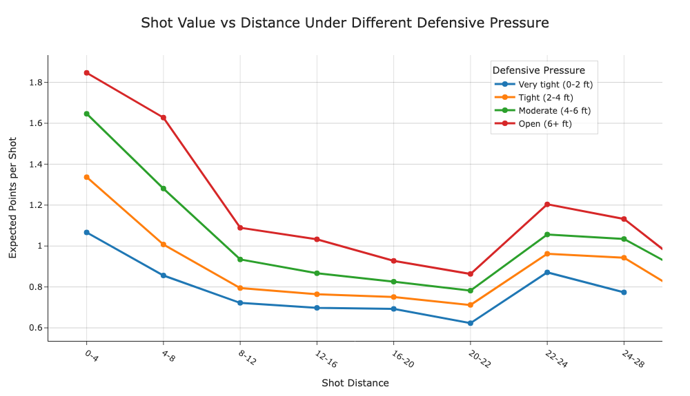

# NBA Shot Value

**A player-agnostic model of the expected point value of an NBA shot.** Logistic regression and
tree models (up to tuned XGBoost) predict make probability from shot context. Multiplying by
point value gives expected points per shot.

[Writeup (PDF)](Project_Writeup.pdf) ·
[Results](#results) · [Reproduce](#reproduce) · [Citation](#citation)

---

## Summary

Which shots are worth taking? Field goal percentage ignores context, so we model each shot from
what the shooter does not control: shot distance, closest-defender distance, shot clock, dribbles,
touch time, period and home/away. The data is 128,069 shots from the 2014–15 NBA season
(122,203 after cleaning). We exclude shooter identity on purpose. Predictability plateaus hard:
**AUC is about 0.63–0.64 for every model class, with or without 15 engineered features**
(tuned XGBoost: accuracy 0.620, AUC 0.6365). What is left over is mostly shooter skill and luck.
The probabilities are still well calibrated, so probability times point value is a usable
expected-value estimate even with that ceiling.

<p align="center"></p>
<p align="center"><sub>Model-predicted expected points per shot by distance bin and closest-defender distance (bins with at least 75 shots), from the tuned XGBoost model.</sub></p>

## Results

Random 80/20 split of the one season (97,762 train / 24,441 test). Hyperparameters were tuned
with `RandomizedSearchCV` and stratified 3-fold CV on the training split only. Engineered adds 15
features (for example `defender_distance_ratio`, `time_pressure_index`, shot-type flags). The tree
models in the engineered column are tuned.

| Model | AUC, raw | AUC, engineered | Accuracy, engineered | Log loss, engineered |
|---|---|---|---|---|
| Logistic regression | 0.6279 | 0.6310 | 0.6122 | 0.6552 |
| Decision tree | 0.6276 | 0.6283 | 0.6153 | 0.6539 |
| Random forest | 0.6355 | 0.6346 | 0.6184 | 0.6508 |
| **XGBoost** | **0.6360** | **0.6365** | **0.6199** | **0.6494** |

Numbers are the live outputs of notebooks 04–07. A constant-probability baseline has log loss 0.6895.

- Engineered features add about +0.003 AUC for logistic regression and almost nothing for trees.
  Tuned random forest is slightly below its untuned raw-feature score. We report that as is.
- Expected value is a U-shape in distance. Open (6+ ft) shots at the rim are worth about 1.85
  points. Very tightly guarded 20–22 ft shots are worth about 0.62. Mid-range is a trough at every
  defensive-pressure level, and the 22–24 ft (corner three) bin is a clear bump above it.
- SHAP ranks `defender_distance_ratio` first, ahead of raw shot distance and touch time. Figures
  are in [`models/`](models/).

## Repository layout

```
notebooks/            01–09, run in order: cleaning, features, EDA, models, EV charts, SHAP/calibration
models/               trained XGBoost model (.joblib) and SHAP / calibration figures
data/                 raw/ and processed/ (CSVs are gitignored)
Project_Writeup.pdf   course writeup
requirements.txt
```

## Setup

Notebooks were run on Python 3.13.

```bash
python -m venv .venv && source .venv/bin/activate
pip install -r requirements.txt
```

## Reproduce

1. Download the 2014–15 shot logs from
   [Kaggle](https://www.kaggle.com/datasets/dansbecker/nba-shot-logs) and save the file as
   `data/raw/shot_logs.csv`. Data files are not in git.
2. Run the notebooks in `notebooks/` in order.
   - `01` cleans the data and writes `data/processed/shot_logs_cleaned.csv`.
   - `02` engineers features and writes `data/processed/shot_logs_cleaned_engineered.csv`.
   - `03` is EDA.
   - `04`–`07` fit the logistic regression and tree models, raw then engineered. `07` tunes and
     saves `models/xgboost_engineered_shot_model.joblib`.
   - `08` builds the expected-value charts, including an interactive ipywidgets zone-by-distance
     heatmap that only runs in a live notebook.
   - `09` writes the calibration and SHAP figures to `models/`.

## Limitations

- One season (2014–15) with a random split, not a temporal holdout. Later changes in league
  shot selection are not captured.
- No court coordinates in the data. Location is shot zone (paint, mid-range, three) times distance
  bin.
- Shooter skill is excluded by design. The expected value of a shot is the league-average value
  for that context, not for a specific player.
- Some labels are noisy. The cleaning step corrects shot types that disagree with distance, such
  as 774 "threes" under 22 ft.
- Notebook text and the PDF quote some raw-feature scores from an earlier run (for example XGBoost
  AUC 0.641 against 0.636 live). The table above uses the current notebook outputs.

## Authors and credits

Nate Seluga and Michael O'Brien, a course project at Harvey Mudd College.

Data: the NBA shot logs dataset for the 2014–15 season on
[Kaggle](https://www.kaggle.com/datasets/dansbecker/nba-shot-logs). Prior work cited in the
writeup includes Goldsberry's *CourtVision*.

## Citation

```bibtex
@misc{seluga2026shotvalue,
  title  = {Context-Aware Shot Value Estimation in the {NBA} Using Machine Learning},
  author = {Seluga, Nate and O'Brien, Michael},
  year   = {2026},
  url    = {https://github.com/nseluga/Shot-Value-Machine-Learning}
}
```
